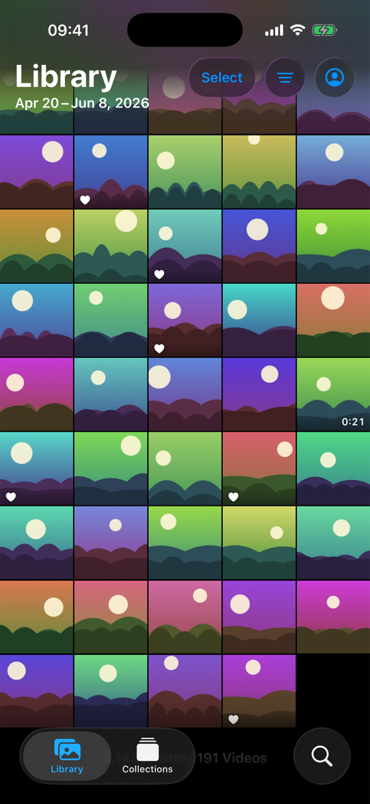
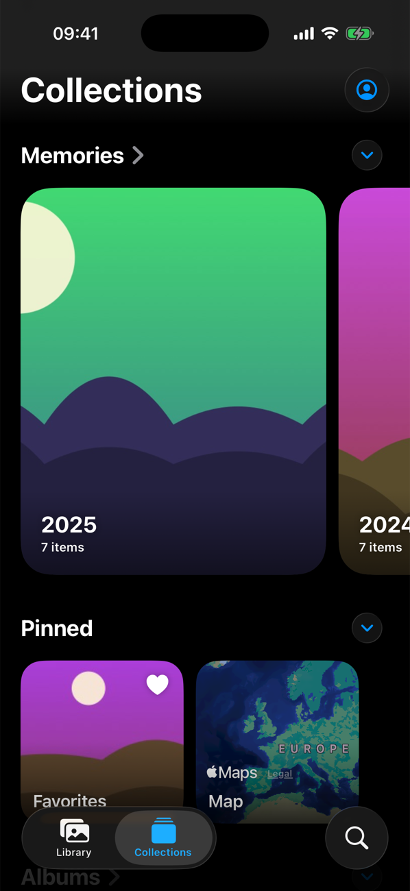
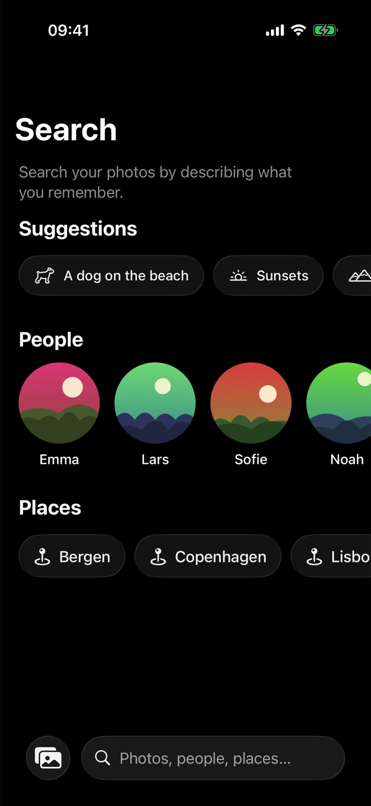

<p align="center">
  
</p>

<h1 align="center">Bloom</h1>

<p align="center">
  A native iPhone client for <a href="https://immich.app">Immich</a> that looks and feels like Apple's Photos app on iOS 26.<br>
  This repository is the Swift package <code>ImmichKit</code>: API client, models, caching and all SwiftUI screens.
</p>

<p align="center">
  
  
  
</p>

## Features

- **Library**: one continuous grid opening at the newest photos, pinch between 3, 5 and 7 columns
  around the photo under your fingers, the dates on screen in the header, Years / Months / All in
  the tab bar (iOS 26.1+), sort, favorites filter and aspect-ratio grid.
- **Viewer**: paging, zoom, swipe down to close with a zoom transition back into the grid, info with
  EXIF, video and Live Photos, share originals, favorite.
- **Collections**: Memories (on this day, by year), pinned Favorites and Map with previews, Albums,
  People, Places, Media Types and Recently Added / Archive / Recently Deleted; sections fold away.
- **Search**: CLIP smart search, suggestions, people, places and recent searches.
- **Editing** (with confirmation where it matters): favorites, move to Immich trash, restore from
  Recently Deleted, create albums and add photos to them.
- Norwegian Bokmål and English, Liquid Glass with fallbacks, a Home Screen icon picker (About Bloom).

Uploading from the iPhone (backup) is not implemented yet: Bloom shows what is on your server.

## Package structure

| Target | Contents |
| --- | --- |
| `ImmichAPI` | Checked-in OpenAPI spec, generator configuration and generated client |
| `ImmichKit` | Domain models, live/mock services, timeline actor, image cache, prefetcher, search and Keychain credentials |
| `ImmichUI` | Login, Library grid (own exact virtualized layout, see `GridLayout`), viewer, Collections, Search, About Bloom and `ImmichRootView` |
| `ImmichKitTests` | Unit tests using the mock, transport fixtures and optional live-server integration tests |

The `ImmichKit` library product exposes all three modules. Deployment targets are iOS 18 and macOS 15; iOS 26
features (Liquid Glass, tab bar accessory) are used when available. macOS compiles the shared UI.

Where each part lives: [`docs/ARCHITECTURE.md`](docs/ARCHITECTURE.md). The logo kit (SVG masters, app icons, colours and usage rules) is in [`Branding/bloom-logo`](Branding/bloom-logo/README.md).

## Create the iPhone app in Xcode

1. Open full Xcode and choose **File → New → Project → iOS → App**. Name it `ImmichPhotos`, select **SwiftUI** and **Swift**, and choose your signing team and a unique bundle identifier. Save the app project beside this package rather than inside its Sources folder.
2. In the app target's **General** settings, set **Minimum Deployments → iOS** to **18.0** or later.
3. Choose **File → Add Package Dependencies… → Add Local…** and select this repository's folder (the one containing `Package.swift`). Add the **ImmichKit** library product to the `ImmichPhotos` app target. Confirm it appears under the target's **Frameworks, Libraries, and Embedded Content**.
4. Replace the generated app entry point with:

   ```swift
   import SwiftUI
   import ImmichUI

   @main
   struct ImmichPhotosApp: App {
       var body: some Scene {
           WindowGroup {
               ImmichRootView()
           }
       }
   }
   ```

   The generated `ContentView` is no longer needed. No API key, server URL or extra service wiring belongs in the app source.
5. Select an iPhone simulator or your signed-in physical device and run. On first launch, enter the server URL and API key in the login screen. The connection test checks an authenticated endpoint before saving to the Keychain. Subsequent launches restore that connection; **Library → Account → Sign Out** clears it and the session's image cache.
6. For a server on your local network, add **Privacy - Local Network Usage Description** (`NSLocalNetworkUsageDescription`) to the app target's Info settings, explaining that the app connects to the user's photo server. Prefer a server with trusted HTTPS. If you deliberately use plain HTTP, configure a narrowly scoped App Transport Security exception in the app target for that server; the package does not disable ATS globally.

Browsing does not require permission to the iPhone's Photos library: images come from Immich. Uploading and saving to the device's photo library are not implemented.

## Language

The app is in Norwegian Bokmål when the device's preferred language is Norwegian (nb, no or nn),
otherwise in English. Texts live in `Sources/ImmichKit/Resources/nb.lproj` and
`Sources/ImmichUI/Resources/nb.lproj` (`Localizable.strings`, keyed by the English text). Wrap new
user-facing text in `tr("…")`; `LocalizationTests` fails if a text has no Norwegian translation.
Dates and month names follow the same language. No setting in the app target is needed.

## App icons

The app target's asset catalog has `AppIcon` (light, dark and tinted) plus the alternate sets
`AppIcon-Light`, `AppIcon-Dark` and `AppIcon-Tinted` from `Branding/bloom-logo/ios/`, with
**Include All App Icon Assets** set to Yes. About Bloom switches between them.

## Preview without a server

All UI screens have mock previews. For a complete app demo, use:

```swift
import ImmichKit
import ImmichUI

ImmichRootView(service: MockImmichService.preview)
```

This root initializer uses an in-memory session and does not read the real Keychain. In Debug
builds the app can also start in this demo mode with the launch argument `-BloomDemo` (and
`-BloomDemoTab collections|search`); the README screenshots are taken that way, in English with
`-AppleLanguages (en)`. Release builds ignore it. The deterministic mock has hundreds of generated photos, albums, people and metadata. Its search uses word matching rather than CLIP, and mock videos show a placeholder because they have no playable media.

## Run all three checks

Run from the package directory with full Xcode installed:

```sh
DEVELOPER_DIR=/Applications/Xcode.app/Contents/Developer swift build
DEVELOPER_DIR=/Applications/Xcode.app/Contents/Developer swift test
DEVELOPER_DIR=/Applications/Xcode.app/Contents/Developer xcodebuild build -scheme ImmichKit -destination 'generic/platform=iOS Simulator' -quiet
```

The prefix is needed for SwiftPM as well on this machine: `xcode-select` points to CommandLineTools, whose Swift 6.1 compiler is too old for the resolved dependency versions. Keep `Package.resolved` when reproducing these builds.

Integration tests skip cleanly unless both `IMMICH_URL` and `IMMICH_API_KEY` are supplied through your local environment. Do not put credentials in source files, shell history, logs or commits. Unit tests and previews need no live credentials.

Known harmless warnings are the unhandled OpenAPI spec/config files in SwiftPM and Xcode's “Supported platforms for the buildables in the current scheme is empty” message. The build must still exit successfully.

## API generation and compatibility

The checked-in spec is **Immich v3.4.0**. **Re-check it against the real server's `/api/server/version` before relying on live compatibility.** Responses from older servers are decoded leniently where fields were added later (for example `featureLevel`).

The OpenAPI generator build plugin is intentionally not enabled: unattended Xcode builds otherwise require plugin approval. Generated sources live in `Sources/ImmichAPI/GeneratedSources/`. Only regenerate after changing the spec or operation filter:

```sh
DEVELOPER_DIR=/Applications/Xcode.app/Contents/Developer swift package --allow-writing-to-package-directory generate-code-from-openapi --target ImmichAPI
```

Commit the generated changes and rerun all three checks.

## Remaining validation

- Re-check the API spec version against the real server and run the integration suite with local credentials.
- Exercise paging, double-tap zoom, downward dismissal, pinch feel and thumbnail transitions on a device; compilation, model tests and simulator probes do not verify animation quality.
- Check authenticated video playback, large libraries, offline/reconnect behavior and Dynamic Type/VoiceOver on a physical iPhone.

The root shares one loader across tabs and namespaces its disk cache by a digest of the connection identity, so different server/account connections do not reuse each other's thumbnails. Custom service integrations that create loaders directly should likewise supply a separate `DiskImageCache` directory per connection.

## License

MIT, see [LICENSE](LICENSE). `Sources/ImmichAPI/openapi.json` is the Immich API specification, published by the Immich project under AGPL-3.0. Bloom is an independent client and is not affiliated with Immich.
