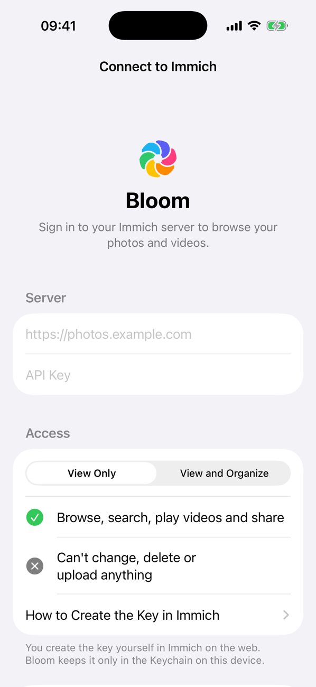

<p align="center">
  
</p>

<h1 align="center">Bloom</h1>

<p align="center">
  A native iPhone client for <a href="https://immich.app">Immich</a> that looks and feels like Apple's Photos app on iOS 26.<br>
  This repository is the Swift package <code>ImmichKit</code>: API client, models, caching and all SwiftUI screens.
</p>

<p align="center">
  
  
  
  
</p>

## Status

A personal hobby project that I use every day with my own Immich server. It is not an official
Immich app and is not on the App Store: you build it yourself in Xcode (see below).

- **Server**: written against the Immich **v3.4.0** API spec and used daily with a **v3.3.6** server.
  Fields that older servers leave out are decoded leniently; other versions are untested.
- **Safe to try**: Bloom starts **view-only**. Nothing on the server changes until you turn on
  **Allow Changes** in the account menu, and even then it never deletes anything permanently.

## Features

- **Library**: one continuous grid opening at the newest photos, pinch between 3, 5 and 7 columns
  around the photo under your fingers, the dates on screen in the header, Years / Months / All in
  the tab bar (iOS 26.1+), sort, favorites filter and aspect-ratio grid.
- **Viewer**: paging, zoom, swipe down to close with a zoom transition back into the grid, info with
  EXIF, video and Live Photos, share originals, favorite.
- **Collections**: Memories (on this day, by year), pinned Favorites and Map with previews, Albums,
  People, Places, Media Types and Recently Added / Archive / Recently Deleted; sections fold away.
- **Search**: CLIP smart search, suggestions, people, places and recent searches.
- **Editing**, once Allow Changes is on: favorites, move to Immich's trash (asks first, and only if
  the server's trash keeps items), restore from Recently Deleted, create albums and add photos.
- Norwegian Bokmål and English, Liquid Glass with fallbacks, a Home Screen icon picker (About Bloom).

Uploading from the iPhone (backup) is not implemented yet: Bloom shows what is on your server.

## Security and privacy

Bloom collects nothing: no analytics, crash reporting, ads or tracking, and it talks only to your
own Immich server. See the [privacy policy](PRIVACY.md).

- **API key**: kept in the iOS Keychain on this device only, never logged. The sign-in screen
  explains how to create a key with only the permissions Bloom needs (View Only, or View and
  Organize), so a leaked key can't do more; see [API key permissions](#api-key-permissions).
- **Transport**: https, or http only on your own network (after asking) or over Tailscale. Plain
  http to the internet is refused, including disguised numeric hosts. No request carrying the key
  follows a redirect to another server, video and Live Photo playback included.
- **Untrusted responses**: malformed or oversized server data is rejected instead of crashing the
  app or filling memory; file names from other people's uploads are cleaned before sharing.
- **On the device**: cached photos and library data are protected while the iPhone is locked and
  removed at sign-out; leftovers from earlier accounts and interrupted shares are cleaned up.

Found a vulnerability? Please report it privately through
[GitHub security advisories](https://github.com/jonesstoen/bloom/security/advisories/new) rather
than a public issue.

## How it was built

Most of the code was written with [Claude Code](https://claude.com/claude-code), Anthropic's coding
agent, working from my instructions and from my testing on a physical iPhone; a few features came
from OpenAI Codex. I decide what gets built, try every change on my own library and read the diffs.
Every change has to pass the package build, the unit tests and an iOS Simulator build. Issues and
pull requests are welcome.

## Package structure

| Target | Contents |
| --- | --- |
| `ImmichAPI` | Checked-in OpenAPI spec, generator configuration and generated client |
| `ImmichKit` | Domain models, live/mock services, timeline actor, image cache, prefetcher, search and Keychain credentials |
| `ImmichUI` | Login, Library grid (own exact virtualized layout, see `GridLayout`), viewer, Collections, Search, About Bloom and `ImmichRootView` |
| `ImmichKitTests` | Unit tests using the mock, transport fixtures and optional live-server integration tests |

The `ImmichKit` library product exposes all three modules. Deployment targets are iOS 18 and macOS 15; iOS 26
features (Liquid Glass, tab bar accessory) are used when available. macOS compiles the shared UI.

How it fits together (data flow, the API layer, the Library grid, safety around changes) and where
each part lives: [`docs/ARCHITECTURE.md`](docs/ARCHITECTURE.md). The logo kit (SVG masters, app icons, colours and usage rules) is in [`Branding/bloom-logo`](Branding/bloom-logo/README.md).

## Create the iPhone app in Xcode

1. Open full Xcode and choose **File → New → Project → iOS → App**. Name it `ImmichPhotos`, select **SwiftUI** and **Swift**, and choose your signing team and a unique bundle identifier. Save the app project beside this package rather than inside its Sources folder.
2. In the app target's **General** settings, set **Minimum Deployments → iOS** to **18.0** or later.
3. Choose **File → Add Package Dependencies… → Add Local…** and select this repository's folder (the one containing `Package.swift`). Add the **ImmichKit** library product to the `ImmichPhotos` app target. Confirm it appears under the target's **Frameworks, Libraries, and Embedded Content**.
4. Replace the generated app entry point with:

   ```swift
   import SwiftUI
   import ImmichUI

   @main
   struct ImmichPhotosApp: App {
       var body: some Scene {
           WindowGroup {
               ImmichRootView()
           }
       }
   }
   ```

   The generated `ContentView` is no longer needed. No API key, server URL or extra service wiring belongs in the app source.
5. Select an iPhone simulator or your signed-in physical device and run. On first launch, enter the server URL and API key in the login screen. The connection test checks an authenticated endpoint before saving to the Keychain. Subsequent launches restore that connection; **Library → Account → Sign Out** clears it and the session's image cache.
6. For a server on your local network, add **Privacy - Local Network Usage Description** (`NSLocalNetworkUsageDescription`) to the app target's Info settings, for example "Bloom connects to your Immich server when it is on your local network." ([`docs/APP_STORE.md`](docs/APP_STORE.md) has the Norwegian text, the app's privacy manifest and the other App Store settings). Prefer a server with trusted HTTPS. Bloom refuses plain HTTP except for servers on your own network (private addresses, `.local` names) or on Tailscale, which encrypts the traffic itself; for those, configure a narrowly scoped App Transport Security exception in the app target. The package does not disable ATS globally, and it never follows a redirect to another server.

### API key permissions

Create the key in Immich under **Account Settings › API Keys** and give it only what Bloom uses,
not "all". A leaked read-only key can't delete, edit or share anything.

| Use | Permissions |
|---|---|
| Browsing, search, map, memories, videos, sharing originals | `asset.read`, `asset.view`, `asset.download`, `album.read`, `person.read`, `map.read`, `memory.read` |
| Also for **Allow Changes** (favorites, trash and restore, new albums, add to album) | `asset.update`, `asset.delete`, `album.create`, `albumAsset.create` |

The lists live in `APIKeyPermissions` (ImmichKit) and are shown on the sign-in screen (Access, and How to Create the Key);
`APIKeyPermissionTests` checks them against the OpenAPI spec. Without a permission the matching
feature shows an error, and the rest of the app keeps working.

Browsing does not require permission to the iPhone's Photos library: images come from Immich. Uploading and saving to the device's photo library are not implemented.

## Language

The app is in Norwegian Bokmål when the device's preferred language is Norwegian (nb, no or nn),
otherwise in English. Texts live in `Sources/ImmichKit/Resources/nb.lproj` and
`Sources/ImmichUI/Resources/nb.lproj` (`Localizable.strings`, keyed by the English text). Wrap new
user-facing text in `tr("…")`; `LocalizationTests` fails if a text has no Norwegian translation.
Dates and month names follow the same language. No setting in the app target is needed.

## App icons

The app target's asset catalog has `AppIcon` (light, dark and tinted) plus the alternate sets
`AppIcon-Light`, `AppIcon-Dark` and `AppIcon-Tinted` from `Branding/bloom-logo/ios/`, with
**Include All App Icon Assets** set to Yes. About Bloom switches between them.

## Preview without a server

All UI screens have mock previews. For a complete app demo, use:

```swift
import ImmichKit
import ImmichUI

ImmichRootView(service: MockImmichService.preview)
```

This root initializer uses an in-memory session and does not read the real Keychain. In Debug
builds the app can also start in this demo mode with the launch argument `-BloomDemo` (and
`-BloomDemoTab collections|search`); the README screenshots are taken that way, in English with
`-AppleLanguages (en)`. Release builds ignore it. The deterministic mock has hundreds of generated photos, albums, people and metadata. Its search uses word matching rather than CLIP, and mock videos show a placeholder because they have no playable media.

## Run all three checks

Run from the package directory with full Xcode installed:

```sh
DEVELOPER_DIR=/Applications/Xcode.app/Contents/Developer swift build
DEVELOPER_DIR=/Applications/Xcode.app/Contents/Developer swift test
DEVELOPER_DIR=/Applications/Xcode.app/Contents/Developer xcodebuild build -scheme ImmichKit -destination 'generic/platform=iOS Simulator' -quiet
```

The `DEVELOPER_DIR` prefix is only needed if `xcode-select` points to the Command Line Tools, whose
compiler can be too old for the resolved dependencies. Keep `Package.resolved` when reproducing builds.

Integration tests skip cleanly unless both `IMMICH_URL` and `IMMICH_API_KEY` are supplied through your local environment. Do not put credentials in source files, shell history, logs or commits. Unit tests and previews need no live credentials.

Known harmless warnings are the unhandled OpenAPI spec/config files in SwiftPM and Xcode's “Supported platforms for the buildables in the current scheme is empty” message. The build must still exit successfully.

## API generation and compatibility

The checked-in spec is **Immich v3.4.0**. When updating it, compare with your server's
`/api/server/version`; Immich renames operations and adds required fields between versions.
Responses from older servers are decoded leniently where fields were added later (for example
`featureLevel`). See [`docs/ARCHITECTURE.md`](docs/ARCHITECTURE.md#talking-to-immich) for which calls
use the generated client.

The OpenAPI generator build plugin is intentionally not enabled: unattended Xcode builds otherwise require plugin approval. Generated sources live in `Sources/ImmichAPI/GeneratedSources/`. Only regenerate after changing the spec or operation filter:

```sh
DEVELOPER_DIR=/Applications/Xcode.app/Contents/Developer swift package --allow-writing-to-package-directory generate-code-from-openapi --target ImmichAPI
```

Commit the generated changes and rerun all three checks.

## Known gaps

- No upload or backup from the iPhone, and nothing is saved to the device's photo library.
- Tested on one iPhone with one library (about 13 000 items). Other server versions, very large
  libraries, offline use and VoiceOver have had little testing.
- Run the integration tests against your own server (`IMMICH_URL`, `IMMICH_API_KEY`) after
  updating the spec.

The root shares one loader across tabs and namespaces its disk cache by a digest of the connection identity, so different server/account connections do not reuse each other's thumbnails. Custom service integrations that create loaders directly should likewise supply a separate `DiskImageCache` directory per connection.

## License

Copyright © 2026 Johannes Støen.

Bloom is free software: you can redistribute it and/or modify it under the terms of the GNU General
Public License as published by the Free Software Foundation, either version 3 of the License, or (at
your option) any later version. It is distributed in the hope that it will be useful, but WITHOUT
ANY WARRANTY; see [LICENSE](LICENSE) for details.

`Sources/ImmichAPI/openapi.json` is the Immich API specification, published by the Immich project
under AGPL-3.0. Bloom is an independent client and is not affiliated with Immich.
